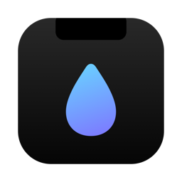
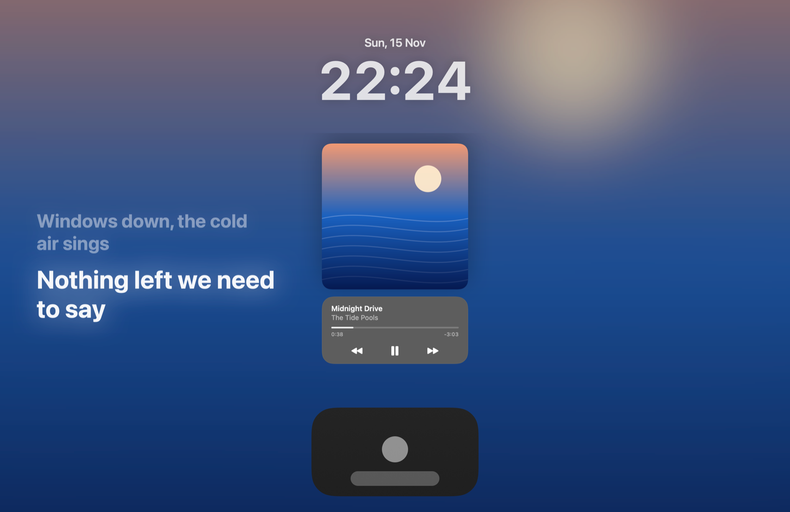
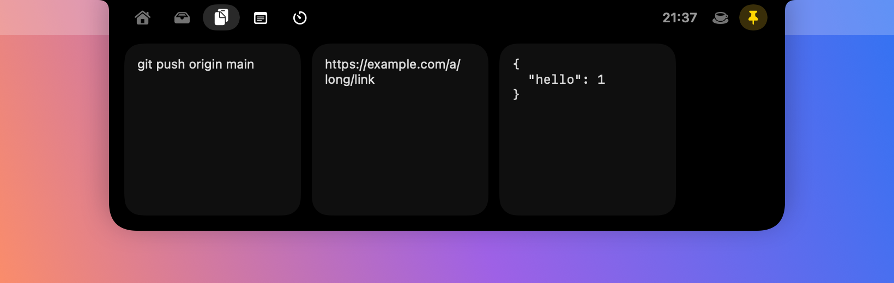
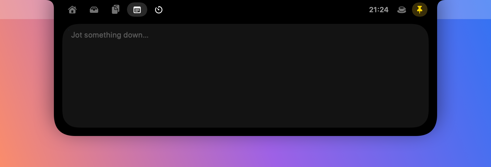

# Droplet

A minimal Dynamic Island for the MacBook notch. Droplet sits exactly over the notch and springs open into a small control centre: now playing, a file shelf, clipboard history, notes and a timer. It is a native Swift/SwiftUI app with no dependencies.


## Features

### The island

- **Invisible until needed.** At rest it matches the notch pixel for pixel. Hover and it grows slightly with a haptic tick; click to open.
- **Smooth motion.** Size changes use soft springs, and content fades and settles in rather than cutting.
- **Gestures.** Swipe down to open, up to close, left/right to change tabs. With the island collapsed, swipe left/right to skip tracks.
- **Open on hover** (optional) so you never have to click.

### Live activities

| | |
|---|---|
|  | **Music + timer.** Artwork and animated bars sit either side of the notch. A second activity splits off as its own small bubble. |
|  | **Track peek.** When the song changes, the island drops down briefly with the title and artist. |
|  | **Timer.** A progress ring and countdown while a timer runs. |
|  | **Volume and brightness.** Level changes show up in the island. |
|  | **Audio devices and power.** AirPods or speakers connecting, and the charger being plugged or unplugged. |

### Lock-screen player

When music is playing and you lock the Mac, a clean artwork card and a small glass player with previous, play/pause and next appear under the lock-screen clock, like on iPhone. The song's cover, blurred, fills the lock screen behind it, leaving a small soft opening at the bottom centre so the account picture and password field stay visible. Because the cover hides the system clock, Droplet draws its own. When timed lyrics are available, the current line appears large beside the player with its neighbours fading into a soft haze. Everything stays until you unlock, so you can resume a paused track. Turn the player off with **Lock Screen Player**, or just the cover with **Lock Screen Cover Backdrop**, in the menu.



### Tabs

**Shelf** — drag files onto the notch to park them, drag them back out anywhere, or AirDrop the lot.


**Clipboard** — your last 15 text copies; click one to copy it again. History is kept in memory only and entries marked as concealed by password managers are skipped.



**Timer** — one-tap presets from 1 to 60 minutes, with a chime and an island alert when it finishes.


**Notes** — a scratchpad that persists between launches.



**Home** shows the current song with its cover and controls on the left, and its lyrics on the right. When timed lyrics are available the current line is highlighted and the list scrolls along with the song. The top bar has a keep-awake toggle and a pin that holds the island open.

## Install and run

Requires macOS 14 or later and the Xcode command line tools (`xcode-select --install`).

```bash
git clone https://github.com/akimaliiev/droplet.git
cd droplet
./build.sh install
```

This builds `Droplet.app`, copies it to `/Applications` and launches it. Use `./build.sh run` to build and launch from the repo folder without installing.

**Turning it on and off:** open Droplet from Launchpad, Spotlight or Finder to turn it on. Open it again while it is running to turn it off. The island briefly shows "On" or "Off" each time.

Droplet has no Dock icon. Look for the drop icon in the menu bar for **Open on Hover**, **Brightness in Island**, **Lock Screen Player**, **Lock Screen Cover Backdrop**, **Online Lyrics & Covers**, **Launch at Login** and **Quit**.

## Permissions and limits

- **Music control** works with Apple Music and Spotify. macOS asks once for permission to control them; without it the buttons do nothing and covers don't load. If you declined, the Home tab shows an **Open Settings** button, or go to System Settings → Privacy & Security → Automation → Droplet. Because the app is ad-hoc signed, macOS may ask again after each rebuild. Browser playback is not detected.
- **Lyrics and some covers come from the internet.** Lyrics are looked up on lrclib.net, and when the player has no cover for a streamed track the cover is looked up through Apple's iTunes Search and then Deezer. Only the song title and artist are sent. Turn both off with **Online Lyrics & Covers** in the menu.
- **Brightness** reads a private system framework, so it may stop working after a macOS update. Turn it off from the menu if it misbehaves.
- **The lock-screen player** uses private window-server calls to draw above the lock screen. If a macOS update removes them, the player just won't appear.
- The system's own volume overlay still appears alongside the island.
- On Macs without a notch, Droplet draws a small pill at the top centre of the screen instead.
- The app is ad-hoc signed and not notarised, so it is meant to be built locally.

## How the screenshots were made

The images above are rendered by the app itself with sample data (`DROPLET_SNAPSHOT=/some/dir Droplet.app/Contents/MacOS/Droplet`) and placed on a gradient backdrop. The song, cover and lyric lines shown are made up.

## Project layout

| File | What it holds |
|---|---|
| `Sources/Droplet/main.swift` | Window, mouse tracking, menu bar item |
| `Sources/Droplet/Model.swift` | Island state, sizing, hover and gesture logic |
| `Sources/Droplet/Services.swift` | Music, audio, brightness, power, clipboard, shelf, timer |
| `Sources/Droplet/IslandView.swift` | Notch shape, gooey bubble, collapsed states |
| `Sources/Droplet/ExpandedView.swift` | The five tabs |
| `Sources/Droplet/LockScreen.swift` | Lock-screen player |
| `Sources/Droplet/Lyrics.swift` | Lyrics and online cover lookup |

## Licence

MIT — see [LICENSE](LICENSE).
