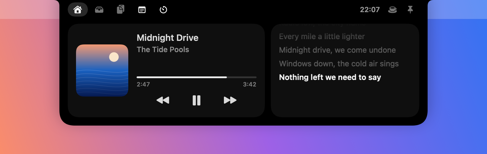
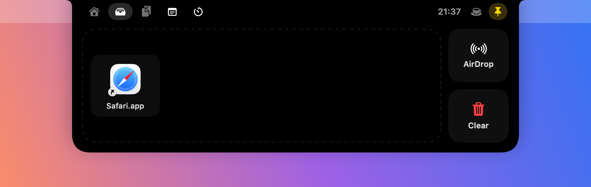
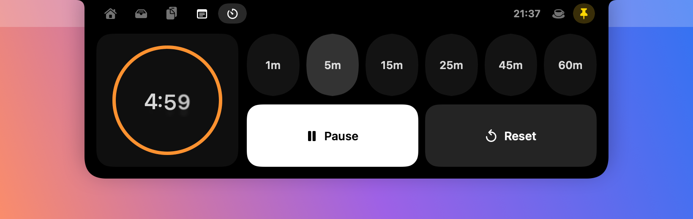

# Droplet

A bubbly Dynamic Island for the MacBook notch. Droplet sits exactly over the notch and springs open into a small control centre: now playing, a file shelf, clipboard history, notes and a timer. It is a native Swift/SwiftUI app with no dependencies.



## Features

### The island

- **Invisible until needed.** At rest it matches the notch pixel for pixel. Hover and it swells with a haptic tick; click and it squishes before opening.
- **Springy everything.** Size changes use bouncy springs, and content blurs and scales in and out rather than cutting.
- **Gestures.** Swipe down to open, up to close, left/right to change tabs. With the island collapsed, swipe left/right to skip tracks.
- **Open on hover** (optional) so you never have to click.

### Live activities

| | |
|---|---|
|  | **Music + timer.** Artwork and animated bars sit either side of the notch. A second activity splits off as its own bubble with a gooey bridge. |
|  | **Track peek.** When the song changes, the island drops down briefly with the title and artist. |
|  | **Timer.** A progress ring and countdown while a timer runs. |
|  | **Volume and brightness.** Level changes show up in the island. |
|  | **Audio devices and power.** AirPods or speakers connecting, and the charger being plugged or unplugged. |

### Lock-screen player

When music is playing and you lock the Mac, a large artwork card and a glass player with previous, play/pause and next appear under the lock-screen clock, like on iPhone. It stays until you unlock, so you can resume a paused track. Turn it off with **Lock Screen Player** in the menu.


### Tabs

**Shelf** — drag files onto the notch to park them, drag them back out anywhere, or AirDrop the lot.



**Clipboard** — your last 15 text copies; click one to copy it again. History is kept in memory only and entries marked as concealed by password managers are skipped.


**Timer** — one-tap presets from 1 to 60 minutes, with a chime and an island alert when it finishes.



**Notes** — a scratchpad that persists between launches.


**Home** also shows a week strip and battery, CPU and memory rings. The top bar has a keep-awake toggle and a pin that holds the island open.

## Install and run

Requires macOS 14 or later and the Xcode command line tools (`xcode-select --install`).

```bash
git clone https://github.com/akimaliiev/droplet.git
cd droplet
./build.sh run
```

`./build.sh` produces `Droplet.app` in the repo folder; `run` also launches it. To keep it around, copy `Droplet.app` to `/Applications` and open it from there.

Droplet has no Dock icon. Look for the drop icon in the menu bar for **Open on Hover**, **Brightness in Island**, **Lock Screen Player**, **Launch at Login** and **Quit**.

## Permissions and limits

- **Music control** works with Apple Music and Spotify. macOS asks once for permission to control them. Browser playback is not detected.
- **Brightness** reads a private system framework, so it may stop working after a macOS update. Turn it off from the menu if it misbehaves.
- **The lock-screen player** uses private window-server calls to draw above the lock screen. If a macOS update removes them, the player just won't appear.
- The system's own volume overlay still appears alongside the island.
- On Macs without a notch, Droplet draws a small pill at the top centre of the screen instead.
- The app is ad-hoc signed and not notarised, so it is meant to be built locally.

## How the screenshots were made

The images above are rendered by the app itself with sample data (`DROPLET_SNAPSHOT=/some/dir Droplet.app/Contents/MacOS/Droplet`) and placed on a gradient backdrop. The clock in the lock-screen image is drawn in for context.

## Project layout

| File | What it holds |
|---|---|
| `Sources/Droplet/main.swift` | Window, mouse tracking, menu bar item |
| `Sources/Droplet/Model.swift` | Island state, sizing, hover and gesture logic |
| `Sources/Droplet/Services.swift` | Music, audio, brightness, power, stats, clipboard, shelf, timer |
| `Sources/Droplet/IslandView.swift` | Notch shape, gooey bubble, collapsed states |
| `Sources/Droplet/ExpandedView.swift` | The five tabs |
| `Sources/Droplet/LockScreen.swift` | Lock-screen player |

## Licence

MIT — see [LICENSE](LICENSE).
